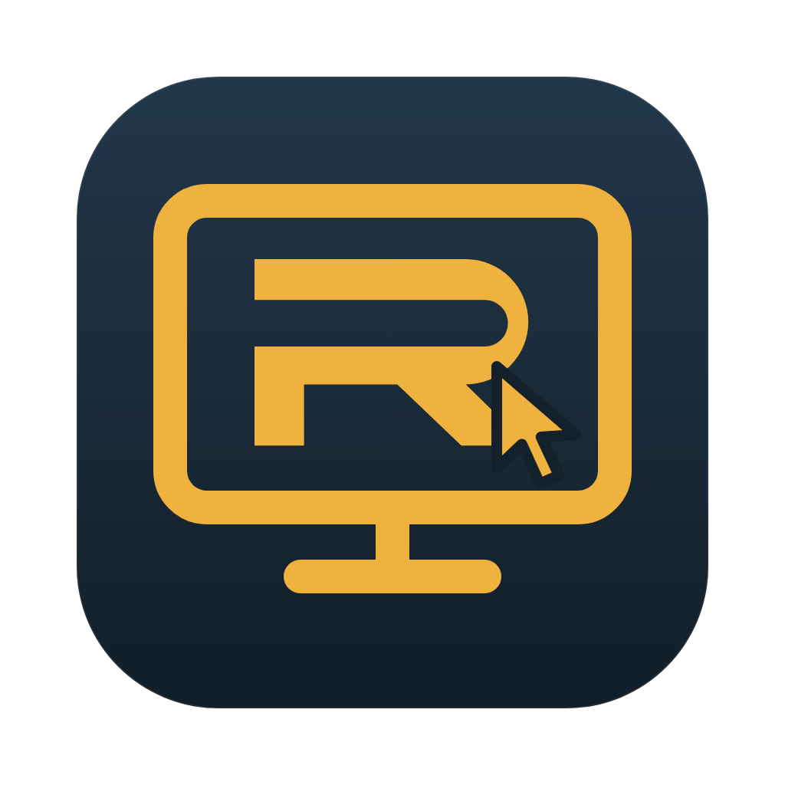

# Ran Remote downloads

Control your computer from your phone or browser.

- [Download for Windows](https://github.com/9172512400n/ran-remote-downloads/releases/latest/download/Ran-Remote-Setup.exe)
- [Download for Mac — Apple Silicon and Intel](https://github.com/9172512400n/ran-remote-downloads/releases/latest/download/Ran-Remote-mac.dmg)
- [Website and installation instructions](https://ranremote.com/download)

This public repository contains official installers, update metadata, and branding only. Application source is kept in a separate private repository.

The Mac 0.3.1 installer is Developer ID signed by RAN INNOVATIONS LLC and notarized by Apple. The Windows 0.3.0 installer is unsigned and may display a first-install security warning.
